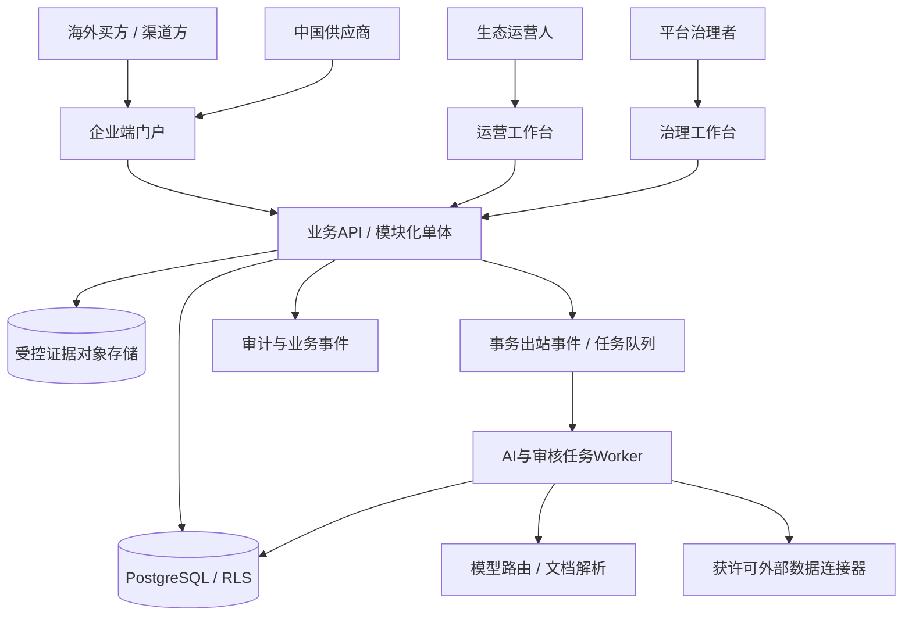
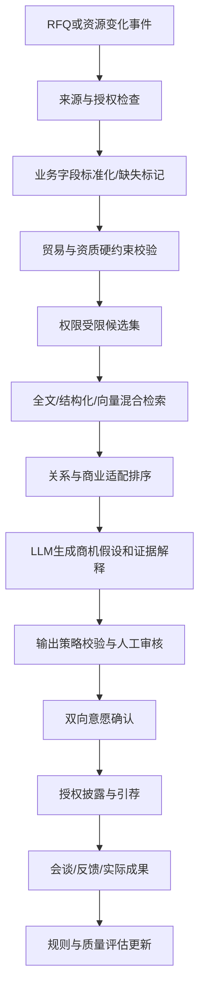

# 艾夫尔·贸合｜跨境供应链 AI 撮合平台

**技术架构研究稿 T0.1（待评审，非冻结版）**  
**编制日期：**2026-11-10  
**唯一业务基线：**`AIFER_Maohe_Business_Architecture_V0.8_FROZEN.md`  
**本轮范围：**应用架构、供应链本体与数据架构、AI匹配与推理、审批工作流、权限安全、集成与部署、成本与验收、首期实施边界。  
**本轮不包含：**创建仓库、迁移既有系统代码、付费模型实验、真实客户数据接入、生产部署。  
**决策状态：**拟议技术方案，待数据跨境合规、首灯塔真实数据和团队条件核实后冻结。

> **技术总原则：**不以“识别企业相似性”冒充“具备采购合作条件”；不以大模型输出作为身份、资质或采购意愿的真实性证明；不以平台拥有数据作为默认授权；不把撮合结果冒充实际订单。任何对外披露或联系必须经过明确授权和责任人审批。

---

## 0. 与 V0.8 冻结决议的映射

| V0.8 决议 | T0.1 技术约束 | 最低验收 |
|---|---|---|
| D1/D2 跨境中国供给↔海外需求 | 贸易方向、产品、目标市场和采购条件为一等业务对象 | 可完成一个真实RFQ样本的供应商筛选 |
| D3 多角色生态 | `Organization`、`Membership`、`BusinessRole` 分离 | 同一主体可在多个生态承担不同角色 |
| D4 需求优先 | 新需求触发发现，推断信号只能生成 `Hypothesis` | 不会生成虚构订单或虚构采购预算 |
| D5 双边优先 | P0仅双边推荐；三方方案为受控 P1 | 不因推荐候选数多而触发复杂组网 |
| D6 人工责任 | 机器只能拟稿/推荐；人工审核、授权、外发 | 未审批不可发引荐信息 |
| D7 证据与授权 | 所有推荐输出带证据和可见性决策 | 未授权的字段不会进入AI上下文与通知 |
| D8 不经手贸易货款 | 无平台货权、库存、支付托管模块 | 不出现虚构交易/付款状态 |
| D9 站外结果 | 可记录双方授权回填的合作里程碑 | 站外报价与成交可分级记录，不强制上传合同 |
| D10 收费 | 独立撮合服务合同及验收证据 | 合格引荐定义可审计；不默认成交佣金 |
| D11 半封闭试点 | 邀请制租户/生态、审计、成本预算 | 无公开全局资源库 |
| D12 独立产品 | 独立代码仓库候选、独立数据库与密钥 | 不共享既有产品的原始客户数据 |

## 1. 关键架构原则与非功能需求

1. **证据优先于生成：**抽取的企业资料、证照、产品参数应映射到具体来源、时间和验证级别。LLM不能凭语气补齐缺失事实。
2. **隐私优先于召回：**某项资源禁止跨空间共享时，它既不应出现在查询结果，也不应进入跨生态向量索引、模型上下文、缓存或日志。
3. **安全决策不交给LLM：**访问许可、硬约束满足、同意状态、是否可外发均在代码/数据库层确定。
4. **流程先于智能：**商机生命周期由事务状态机控制；AI只作为有可替代性的任务执行者。
5. **低复杂度优先：**初期使用模块化单体、单独Worker及PostgreSQL；用指标证明需要拆分时再升级。
6. **人对外负责：**对客户引荐、资料解锁、商务承诺和合规例外都必须有审计可追责的人类审核人。
7. **可比较、可回退：**相同样本下的人工作业、规则方案和LLM方案均可复现并做质量/成本对照。
8. **区域合规先决：**在法律、数据分类、主体及跨境传输路径未核实前，不冻结生产部署地域或将中国境内个人信息默认发送至海外模型。

首期质量目标建议（评审指标，非已有性能）：无未授权披露；核心写入事件可幂等；关键数据按租户默认拒绝；P0支持人工回退；针对同一RFQ可保存输入版本、匹配候选、拒绝原因、证据链及成本。

## 2. 业务上下文与应用架构

### 2.1 用户应用入口

- **买方/渠道端**：申请邀请、提交RFQ/渠道需求、确认约束、查看授权范围内的候选商机卡、表达会谈意愿、反馈商务成果。
- **中国供应商端**：企业主体及资质、可提供产品/产能、MOQ、交期、可服务市场、证据上传、意愿确认、对接和进展。
- **生态运营端**：空间管理、邀请审核、资料核验、商机审核、授权安排、双方对接、跟进和收费证据。
- **平台治理端**：组织/角色权限、数据目录、模型预算、策略版本、日志审计、投诉/撤回、备份与恢复。

### 2.2 系统上下文图



**拟议技术栈：** 前端 TypeScript/Next.js，后端 Python/FastAPI（Pydantic类型契约），PostgreSQL（关系数据、全文检索、pgvector），S3兼容对象存储，后台Worker（首期简单数据库任务队列或经过评估的轻量作业队列），集中身份提供方/OIDC，以及OpenTelemetry类可观测接口。**此处是技术候选，不代表已部署。**

### 2.3 后端模块边界（单体内逻辑隔离）

| 模块 | 业务边界 | 对外接口原则 |
|---|---|---|
| Identity & Ecosystem | 组织、成员、邀请、角色 | 身份归属与生态空间权限校验 |
| Supply Catalog | 产品、规格、产能、服务能力 | 写入需归属验证与资料版本 |
| Demand Intake | RFQ、采购约束、来源 | 原始陈述与AI抽取分开 |
| Evidence & Claim | 事实主张、来源、核验记录 | 未核验不得提升到官方验证 |
| Authorization | 数据使用授权、分享及撤回 | 每次读取/披露可重算权限 |
| Matching | 硬约束、候选检索、排序与解释 | 返回解释与拒绝原因，绝不直接授权外发 |
| Opportunity | 假设、审核状态、商机卡 | 强状态机与审批人 |
| Introduction | 双向同意、有限披露、引荐事件 | 只允许显式审批触发 |
| Collaboration | 会谈、进度、报价/样品/合同事实 | 以可核验程度细分状态 |
| Commercial & Analytics | 计费事件、成本、漏斗、效果 | 与撮合/贸易成交分离 |
| Governance & Audit | 数据保留、撤回、投诉、审计 | 数据生命周期与追责 |

不需要独立微服务即可实现这些边界；跨模块写入使用事务/领域事件，而非彼此直接修改表。

## 3. 供应链本体与数据架构

### 3.1 四层数据模型

1. **主体层**：`Ecosystem`、`Organization`、`Representative`、`Membership`、`Role`，同一企业可同时是买方、供应商、渠道和专业方；一个主体可能属于多个组织运营的生态。
2. **业务资源层**：`Product`、`Capability`、`SupplyOffer`、`Demand`、`Constraint`、`Relationship`、`MarketScope`、`Signal`。商品编码/行业分类保留来源及适用范围，不能把推测HS编码作为合规结论。
3. **证据授权层**：`Claim`、`Evidence`、`Verification`、`UsageGrant`、`ShareGrant`、`DisclosureRecord`、`DataPolicy`、`AuditEvent`。个人信息合法处理依据、商业合同授权、技术访问许可需分开存储和检查。
4. **撮合协作层**：`MatchRun`、`Candidate`、`Hypothesis`、`Opportunity`、`IntroductionRequest`、`PartyApproval`、`Collaboration`、`Milestone`、`Outcome`、`ChargeableEvent`。

### 3.2 最重要的语义区分

- `Claim`：主体或文档中的**一项事实主张**，例如“具有某认证”。
- `Evidence`：支持/反驳该主张的可追溯来源，记录上传者、文件版本、时间、文件哈希与核验方式。
- `Verification`：人工或可信外部来源的核验结论，包含核验人、依据、日期和过期时间。
- `Hypothesis`：机器或人发现的**潜在合作可能性**，并不代表有采购承诺。
- `Opportunity`：完成指定审核后的可推进商机，但仍不等于订单。
- `Outcome`：有可核验证据的推进/签约/订单/回款事实，允许标记“企业单方自报”“双方确认”“第三方文件证明”等层次。

### 3.3 资源与需求关键属性

跨境采购需求最少支持：买方主体、目标市场与交付地、采购产品/规格、采购量或量级（可设保密）、质量和认证要求、时间窗口、币种/报价偏好、Incoterms条件（可选）、来源、可信状态、负责人、有效期、可共享范围。

供应资源最少支持：供应主体、产品规格与支持工艺、产地、出口市场、MOQ与产能、可支持认证/检测文件、交期范围、供货约束、证据状态、联系人可见性、资料版本和有效期。

**缺少关键字段必须标记`UNKNOWN`、要求补资料或拒绝合格推荐，不能由LLM填补。**

### 3.4 关系模型及实体归一

- 关系边具备：`source_object_id`、`target_object_id`、`relation_type`、`source/evidence`、`valid_from/to`、`visibility_scope`、`verification_status`、`tenant_owner`。
- 首期建模：`SUPPLIES`、`REQUIRES`、`DISTRIBUTES_IN`、`HAS_CAPABILITY`、`HAS_CERTIFICATION_CLAIM`、`HAS_REFERRED`、`AUTHORIZED_TO_SHARE`、`HAS_COLLABORATED`。
- 主体归一涉及中英文名称、曾用名、统一社会信用代码及其他当地合法企业标识；同名不自动合并，低置信度实体进入人工复核。
- 首期用PostgreSQL关系表和受限递归查询，不预先引入Neo4j。未来仅在关系查询深度、规模及延迟指标达到瓶颈时评估图引擎。

### 3.5 存储与索引

| 数据 | 建议存储 | 必要保护 |
|---|---|---|
| 结构化实体与审批 | PostgreSQL | 租户RLS + 角色及记录级授权 |
| 证据PDF、图片、原始文件 | 对象存储 | 加密、签名限时访问、恶意文件检查、访问日志 |
| 文本抽取与语义索引 | PostgreSQL FTS + pgvector | 只索引各用户**被授权可用于匹配的投影字段** |
| 模型输入输出与成本账本 | 受控表/安全日志 | 敏感信息脱敏、访问隔离、按政策留存 |
| 审计事件 | append-only式事件表及备份 | 防篡改策略、时间、操作者、审批依据 |

**向量检索注意**：pgvector近邻搜索与过滤的行为会受到索引和过滤选择影响；多租户共享近似索引可能影响检索召回和性能。初期小样本优先准确、先授权后过滤，再评估是否需要HNSW/分区；拒绝“跨生态全量私有文本统一向量化后再试图在输出时脱敏”的做法。

## 4. 核心难题：跨生态匹配如何不泄密

跨境生态平台最大的技术陷阱是：既想用全网数据自动发现关系，又想确保每个园区或企业资料不被外部看见。**必须把可参与匹配的数据授权当作搜索之前的约束，而不是结果生成之后再检查。**

建议三级可见性：

- **Private**：原始需求/资质/联系人，仅所有者及明确授权运营角色可见；不得进入跨生态索引、模型上下文、日志。
- **Discoverable**：所有者明确授权发布的脱敏匹配投影（例如产品能力、国家、采购类别、证据核验等级），允许在指定生态/合作范围内做受控匹配；不可推出未经授权的个人身份。
- **Share-on-approval**：双方同意后按字段生成一次性/限期分享权限；联系方式和详细商务条款另行授权。

跨生态匹配流程：

1. 数据持有方选择匹配用途、允许的属性、对方生态范围、有效期、撤回方式。
2. 系统建立最小化`PublishedProjection`，不复制原始敏感字段；如果连合作存在性都属秘密，则不得建立跨生态投影。
3. 检索仅使用具备有效`MatchGrant`的投影；请求上下文通过授权规则裁剪候选全集。
4. 输出“存在值得征求意愿的匹配”时，先审计是否允许暴露对方存在/能力特征，防止成员关系推断攻击。
5. 用户同意、被引荐对象同意且审批通过之后，才创建受限`IntroductionGrant`，释放必要信息。
6. 撤回时立即停止新匹配、删/失效投影和缓存、阻止未完成披露；依法需要保留的审计与已合法发生的合同记录另外分类处理。

**默认无授权，即无跨生态匹配。** 即使平台运营者有技术最高权限，也不意味着具备使用客户资料做商业撮合的合法权利。

## 5. AI 撮合架构

### 5.1 分层执行流水线



### 5.2 四种引擎，各司其职

- **Extraction**：文件/对话理解，输出结构化字段与来源跨度；字段缺失=unknown；需要字段级置信与人工纠错。
- **Eligibility Rules**：硬条件、授权、证据有效期、市场/禁限规则；结果`PASS/FAIL/UNKNOWN/REVIEW_REQUIRED`，LLM不得改写。
- **Candidate Search**：结合类型、国家、工艺、产品关键字、全文、向量及关系路径筛选；首期无需通用知识图谱大规模遍历。
- **Business Explanation**：AI生成适配原因、冲突、缺失、建议联系问题、可实施的下一步；每条关键事实绑定`claim/evidence` ID，无法引用则标为假设。

### 5.3 排序而不制造假精确

- 第一阶段先过滤绝对不满足条件者（如必要认证缺失且不接受补办、供货市场不覆盖、未授权）。
- 第二阶段可用规则化等级：`STRONG_CANDIDATE`、`POTENTIAL_WITH_GAPS`、`INSUFFICIENT_EVIDENCE`，并给出匹配维度和缺口。
- 如引入数值排名，数值仅服务内部A/B排序，需经过历史样本校准；**不向客户展示未经校准的“合作成功率85%”。**

### 5.4 触发机制与预算

- `DemandCreated/Updated` → 异步规范化、权限校验、推荐候选。
- `ResourceUpdated` → 只重算与变化字段相关且被授权的活跃需求。
- `EvidenceExpired/GrantRevoked` → 阻止继续披露/重新审核受影响商机。
- `PartnerResponse` → 更新商机与双方同意状态；绝不自动发送下一轮营销消息。
- 引入去重键`(tenant_id, event_type, entity_id, entity_version, policy_version)`、幂等消费、重试上限、死信队列、成本阈值与人工停止按钮。
- 默认模型只执行只读分析与建议；任何对外触达、报价承诺、资料解锁由独立业务API经审批执行，不授予LLM写权限。

### 5.5 模型可替换

模型提供方以适配接口抽象；可选不同国内/国际模型，但**按用户数据所在地区、信息分类、合法跨境传输路径和合同要求路由**，不能因为成本低就默认将中国境内个人信息或未公开客户资料发送至境外。

记录模型名称/版本、prompt策略版本、输入摘要哈希、调用成本、token用量、延迟、输出结构验证结果及审核意见。关键证据文本可能需要脱敏后才能进入追踪记录。

## 6. 商机状态机与人工授权

```
DRAFT_HYPOTHESIS
  -> PENDING_VERIFICATION
  -> VERIFIED_OPPORTUNITY
  -> PENDING_PARTY_A_CONSENT
  -> PENDING_PARTY_B_CONSENT
  -> INTRODUCTION_APPROVED
  -> INTRODUCED
  -> COLLABORATING
  -> OUTCOME_RECORDED
```

每一阶段均有`REJECTED/EXPIRED/REVOKED/NEEDS_MORE_EVIDENCE`等拒绝、超期、撤回或退回分支。状态跳转必须满足服务端策略校验；LLM返回的文字不构成状态跳转授权。

| 转移 | 必要事实/批准 |
|---|---|
| 推断→待核验 | 触发信号与引用证据可追溯 |
| 待核验→已审核 | 人工核验、关键硬约束审查与有效权限 |
| 已审核→同意征求 | 对外展示的商机摘要通过披露策略 |
| 单方同意→双向同意 | 双方逐一明确同意且未过期 |
| 双向同意→引荐 | 有审批记录、被允许披露的具体字段 |
| 引荐→商务协作 | 有真实联系人和会谈/后续动作记录 |
| 商务协作→结果 | 证据级别明确，不能把意向记录标记为成交 |

**特别注意：**“企业允许用于内部匹配”与“允许将资料发给第三方”是两个不同授权事件；同意的撤回、可见范围变更必须影响未来操作。

## 7. 安全与合规架构

### 7.1 身份授权

- OIDC身份；组织/生态成员关系；角色权限（RBAC）；租户、字段、资源所有者、授权用途、有效期与合作审批的属性策略（ABAC）。
- PostgreSQL启用RLS，对私有多租户业务表采用`FORCE ROW LEVEL SECURITY`并使用无`BYPASSRLS`的低权限运行账户。
- 运营后台和Worker不能长期使用数据库超级用户或`service_role`绕过安全策略；如必须使用管理级操作，收口成独立的受审计高权服务。
- 数据库连接池使用受控事务范围内的租户身份设置；任何会话上下文必须在连接回收前清除。自动化测试覆盖连接复用后跨租户读取。
- 对象存储、模型上下文、导出、邮件通知、缓存、搜索索引都使用相同的授权裁剪规则；只有SQL的RLS远远不够。

### 7.2 典型安全攻击面

| 风险 | 控制措施 |
|---|---|
| 恶意上传资料提示模型泄密 | 文件内容作为不可信数据；不赋予模型外发、查私有库和执行管理动作权限；提示注入专项测试 |
| 跨生态索引泄漏 | 授权前不写公共索引；专门的受控投影；负例与撤回测试 |
| 联系方式外泄 | 分级字段披露、双向授权、短期链接、审计与速率限制 |
| 权限升级或IDOR | 服务端鉴权+DB RLS；跨租户ID互访负例 |
| 虚构资质/贸易合规 | Claim/Evidence/Verification分离、过期检查、专业复核 |
| 制裁或出口限制误判 | 如适用，使用权威清单及专业复核；屏蔽自动“放行”结论 |
| 模型成本失控 | 任务预算、去重、最大token、模型级阈值、熔断、告警 |
| 审计数据被滥用 | 数据分类、最小保留、脱敏、专用权限 |

OWASP的提示注入建议明确指出：模型输出和外部资料均不能作为可信指令；工具权限和行为审批必须在模型之外强制执行。

### 7.3 跨境数据和贸易合规前置研究

在确定生产区位前形成书面决策：经营主体所在地、供应商及买方所在法域、个人信息/重要数据/商业秘密类别、存储地、模型处理地、跨境传输的必要性与合法合规路径、是否适用个人信息出境评估/认证/合同机制或例外。

- 中国个人信息跨境传输相关制度在2026年有更新；不要在未做评估前默认香港或新加坡服务器就能直接存储中国境内全部客户与联系人信息。
- 对进出口交易按商品、目的地、参与主体、支付及物流链判断适用的出口管制和制裁义务；公开制裁清单匹配仅用于发现风险信号，不等于法律结论。
- 首期不做平台自有“贸易合规自动放行”。

## 8. 外部集成与数据来源

| 集成源 | P0建议 | 原则 |
|---|---|---|
| 企业主动上传资料 | 必须 | 验证身份、用途授权、恶意文件检查 |
| 生态运营方现有企业目录 | 有授权才接入 | 合同明确用途、字段、留存、撤回与转授权 |
| 海外采购RFQ | 必须有可实证样本 | 区分公开线索、买方直接授权和二手传闻 |
| 官方工商/资质验证 | 视供应商/合法接入能力 | 不伪称所有政府信息具实时API |
| 海外贸易管制/制裁清单 | 可研/需专业合规审核 | 清单来源、更新时间、适用法域和人工判断 |
| 邮件/WhatsApp/企业微信 | P0可做人工辅助和记录 | 不自动批量冷触达；需接入授权和渠道合规 |
| ERP、CRM、关务、支付 | P1/P2按需 | 不为首个试点建设大型集成中台 |

贸易限制清单候选可参考美国ITA Consolidated Screening List及OFAC Sanctions List Service等官方来源，但不表示所有中国出口业务都一律适用美国规则；采用时必须评估适用法域与服务条款。

## 9. 部署与运维架构

**建议物理分层**：

- 前端Web：可托管在符合数据区域及访问需求的前端运行环境；避免把商业秘密和长期敏感数据嵌在页面或公开构建产物。
- API服务：同区域、最小权限访问数据库；持久API与worker不要完全依赖无状态短时函数执行。
- PostgreSQL：托管实例，专库/专项目，RLS开启；测试/生产隔离；跨区域备份策略须符合法律边界。
- Worker：按任务租户、数据敏感级别、模型区域划分工作队列；可重试、可熔断、可追踪。
- 对象存储：加密、按文件和资源授权下载；禁止公共bucket承载客户资料。
- 观测：请求追踪ID、任务成本、审核耗时、越权尝试、模型失败、供应商资料过期与数据撤回回收状态。

**部署区域：尚不冻结。** 可评估中国大陆合规区域、香港、其他海外区域及分区部署的适用性；决策顺序是数据/法律/用户访问场景先于云服务价格。首期不要无业务证据就购买永久VPS、部署Kubernetes或多地域高可用集群。

**基础可靠性设计**：数据库事务与业务事件原子写入（outbox），任务幂等，后台重试，死信处理，健康检查，日常备份及按期恢复演练，模型失败回退为人工任务。

## 10. 成本框架与模型治理

每条匹配任务记录：

`tenant_id`、`match_run_id`、候选召回量、硬约束拦截量、模型调用次数/输入输出token、检索延迟、人工核验分钟数、外部核验费用、对接结果和复核返工成本。

设定三个预算闸门：

1. **单次RFQ匹配任务上限**：首次实验由运营批准的金额、最大候选数与最大推理轮数，不默认为无限重试；模型超额转人工。
2. **生态空间日/月预算**：生态运营方可设额，平台审计外部模型开支；每次超限有明确告警与拒绝路径。
3. **质量优先闸门**：成本下降不得以越权、核心硬约束错误或无法解释的推荐为代价。

成本不应只看token。完整单位经济还包括人工建档、核验、引荐、商务跟进、数据获取、软件固定费用与客户支持成本。

## 11. 复用 vs 自研 vs 暂缓

| 能力 | 建议 | 理由 |
|---|---|---|
| Web认证、对象存储、任务队列、基础监控 | 成熟托管/开源组件 | 不构成差异化，优先降低工程成本 |
| 贸易供应链本体与证据模型 | **自主设计** | 决定匹配是否可信与可解释 |
| 授权后的跨生态安全投影 | **自主设计** | 平台最重要的信任边界和商业差异化 |
| RFQ硬约束、候选召回、商机卡契约 | **自主设计** | 直接决定业务成果与核验质量 |
| 现成大模型、Embedding、OCR | 采购可替换服务 | 先评估数据合法处理地、成本与准确率 |
| 外部合规及企业核验 | 合法渠道/专业服务合作 | 不擅自自建资质认证机构 |
| 跨生态数据共享中台、独立图数据库 | 暂缓 | 先验证真实深层关系查询需要 |
| 自治商务谈判Agent、站内支付、贸易ERP | 不做P0 | 与V0.8冻结边界不符 |
| VEYFRONT/L2M/Vey2GE/DGS已有代码 | 先审计、后决定 | 不默认克隆、共享客户数据或共享数据库 |

**Git仓库建议**：若后续进入开发，应由艾夫尔项目单独建立仓库（工作名 `aifer-maohe`，仅为建议），按 `apps/web`、`services/api`、`services/worker`、`packages/contracts`、`docs` 组织。**本轮未创建仓库。**

## 12. P0最小闭环与验收契约

### 12.1 第一条业务“黄金路径”

1. 邀请两家经确认的生态成员，完成主体及授权代表建档。
2. 买方在合法授权下提交一条真实或获准用于试验的采购RFQ，包含至少5类有效业务约束。
3. 供应商提交产品/产能/资质/供货条件及相关证据。
4. AI解析RFQ与供应档案，规则检查硬条件、权限与证据有效期。
5. 生成不超过约定数量的候选商机卡：`匹配依据 / 证据 / 缺口 / 风险 / 下一步`。
6. 运营人员核验并确认对外摘要，双方分别决定是否同意引荐。
7. 经双方同意后按字段授权建立商务引荐，记录会谈、后续任务与实际推进。
8. 双方授权后记录结果和成本；同组需求完成AI与人工对照。

### 12.2 最低测试集

| 验收项 | 必须满足 |
|---|---|
| G1 合法资料来源 | 无授权资料不得建公开投影或外发 |
| G2 负向跨租户访问 | 直接ID/API访问、搜索、向量、文件链接、缓存均不能越权 |
| G3 提示注入与模型越权 | 上传文件指示导出客户资料时，不能执行或影响权限 |
| G4 需求真实性 | AI推断不得伪造真实RFQ、订单或采购确认 |
| G5 贸易条件 | 硬条件不满足时不进入“合格推荐”，未知须标注 |
| G6 证据时效 | 过期资料在再匹配或分享前触发重审 |
| G7 双向授权 | 单方同意不足以披露联系方式与受限信息 |
| G8 授权撤回 | 新检索、推荐、分享、未完成任务/缓存受撤回影响 |
| G9 商务结果 | 只有明确可核实依据才允许记录“签约/订单”状态 |
| G10 可靠性 | 重试不产生重复收费、重复商机或重复外发 |
| G11 模型成本 | 单次与每日预算可阻断重复高额任务 |
| G12 业务价值 | 同一任务上有人工基线、处理工时与有效对接反馈 |

**重要**：G1–G11为必须满足的工程/安全门禁，G12为商业价值证据；即使测试全部通过，也不等于实际获得海外订单。

## 13. 技术开发阶段与Go/No-Go

| 阶段 | 工作内容 | 阶段输出 | 是否可立即开发 |
|---|---|---|---|
| **T0.1 本轮** | 设计备选架构、约束与风险 | 本文档 | 已完成设计，不开发 |
| **T0.2 架构评审** | 数据/权限/模型/部署区域ADR决策 | 架构冻结稿、领域契约 | 需评审 |
| **T1 数据与授权基础** | 建表、RLS、权限网关、来源证据、合成数据 | 安全与契约测试 | T0.2通过后 |
| **T2 匹配最小内核** | RFQ解析、过滤、检索、解释、商机卡 | 对照评测及模型成本账本 | T1通过后 |
| **T3 撮合业务闭环** | 双向审批、引荐、合作状态、结果反馈 | 端到端合成演练 | T2通过后 |
| **T4 灯塔受控试点** | 真实授权RFQ、小规模运营、对照复盘 | 实际对接、工时、收费证据 | 合规与审批通过后 |

**建议最小团队：** 一名业务场景负责人（能拿到真实海外需求并组织双方），一名具备数据/安全能力的后端及AI负责人，一名兼顾前端与验收的工程支持，以及按需参与的跨境合规/供应链专家。这里是角色配置，不保证一人即可兼任全部职责。

## 14. T0.2之前必须解决的五个架构决策

1. **首灯塔的需求与供给数据来源**：是否存在可合法使用、可回访、近期有效的真实海外采购需求？包括谁有权授予使用权限。
2. **部署与模型处理区域**：根据数据分类及跨境传输法律评估选择单区域或分区方案，不让某个云平台默认决定法律方案。
3. **跨生态匹配的授权口径**：运营主体可不可以先公开脱敏供给摘要；允许跨生态发现的属性、对象、期限和退出机制具体是什么。
4. **核验责任边界**：谁核查供应商资质、买方真实性、出口限制疑点；核验多久更新一次，争议谁处理。
5. **初始商业实验样本**：真实RFQ、供给档案、匿名化/合成负样本、人工基准和实际服务付费意愿的获取路径。

**本轮不应擅自替这五个问题做事实性决定。** 可以设计默认拒绝和安全机制，但不能因缺少证据而假定某一资源网络、合规路径或商业回款已经成立。

## 15. 关键ADR（Architecture Decision Records）候选

| ADR | 提议 | 状态 |
|---|---|---|
| ADR-001 | 模块化单体与独立Worker，初期不微服务 | 推荐 / 待冻结 |
| ADR-002 | PostgreSQL关系模型为主，pgvector为辅，不立即图数据库 | 推荐 / 待性能验证 |
| ADR-003 | 跨生态匹配使用最小化已授权投影，不全局索引私有数据 | **安全原则必须成立** |
| ADR-004 | 人工批准对外行动，LLM仅给建议 | **与V0.8一致的硬约束** |
| ADR-005 | Python/FastAPI + TypeScript/Next.js | 候选 / 依团队能力复核 |
| ADR-006 | 数据区域与模型路由由合规评估决定 | 未决定 / 不得跳过 |
| ADR-007 | 优先轻量任务队列，复杂长流程再评估Temporal | 推荐 / 待需求验证 |
| ADR-008 | 独立仓库、独立数据库、独立密钥，跨产品只通过经授权API | 推荐 / 待开发授权 |

## 16. 下一阶段交付建议

**建议下一轮直接推进T0.2“技术架构冻结评审包”，而不是立刻开始RA式大规模开发。** 输出应包括：

- 领域实体ERD与数据字典（含证据/权限/时效和敏感度）；
- 跨生态授权矩阵与“匹配可见、对外不可见”的接口契约；
- Golden Path API及事件契约（纯合成）；
- 模型与人工作业对照评估规范；
- 部署区域/数据出境合规决策表；
- 模块工程计划与最小预算上限；
- Go/No-Go评审表。

---

## 17. 参考资料（核对日期：2026-11-10）

1. PostgreSQL行级安全：<https://www.postgresql.org/docs/current/ddl-rowsecurity.html>
2. pgvector官方README（过滤、HNSW与多租户）：<https://github.com/pgvector/pgvector#filtering>
3. Supabase pgvector文档：<https://supabase.com/docs/guides/database/extensions/pgvector>
4. OWASP LLM提示注入防护：<https://cheatsheetseries.owasp.org/cheatsheets/LLM_Prompt_Injection_Prevention_Cheat_Sheet.html>
5. 美国国际贸易署出口限制筛查清单：<https://www.trade.gov/consolidated-screening-list>
6. 美国OFAC官方清单：<https://ofac.treasury.gov/sanctions-list-service>
7. 美国国会图书馆关于2026年中国个人信息出境认证规则的法律摘要：<https://www.loc.gov/item/global-legal-monitor/2026-02-19/china-certification-measures-issued-for-cross-border-transfers-of-personal-data/>
8. OpenFGA架构文档（未来复杂关系授权可选）：<https://github.com/openfga/openfga/blob/main/docs/architecture/architecture.md>
9. Temporal官方工作流文档（后期复杂任务编排可选）：<https://docs.temporal.io/tasks>

> 所有技术选型应在正式进入开发前进行版本、许可证、云区域与价格复核。本文件为架构设计，不等同于已经完成的真实系统工程验证、生产合规结论或商务成果。
